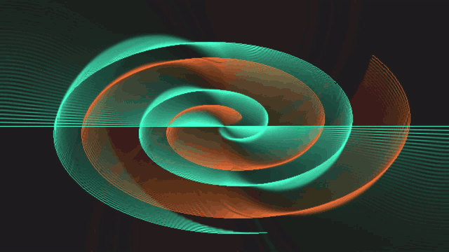
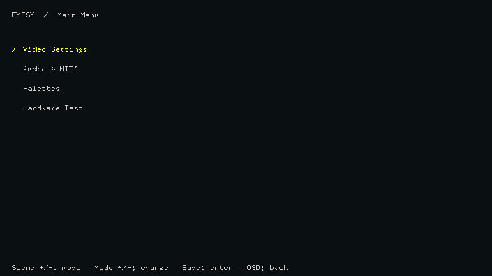
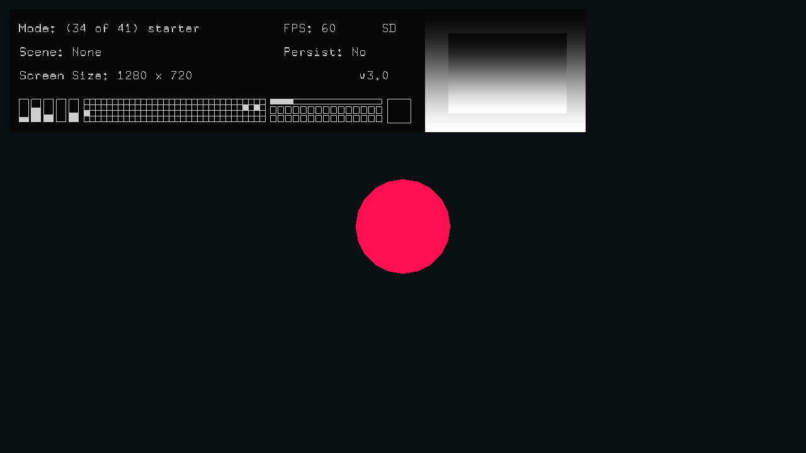
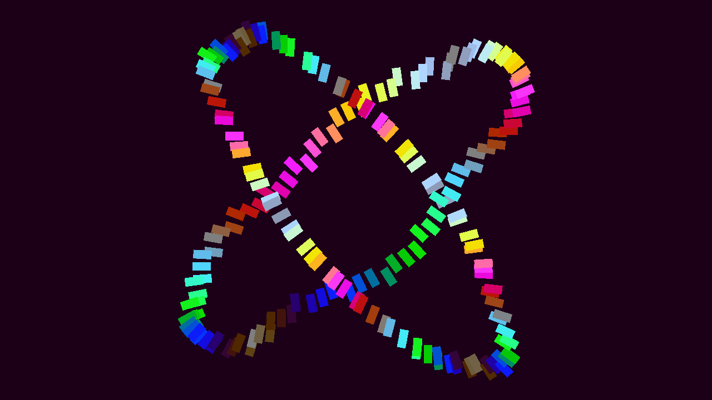
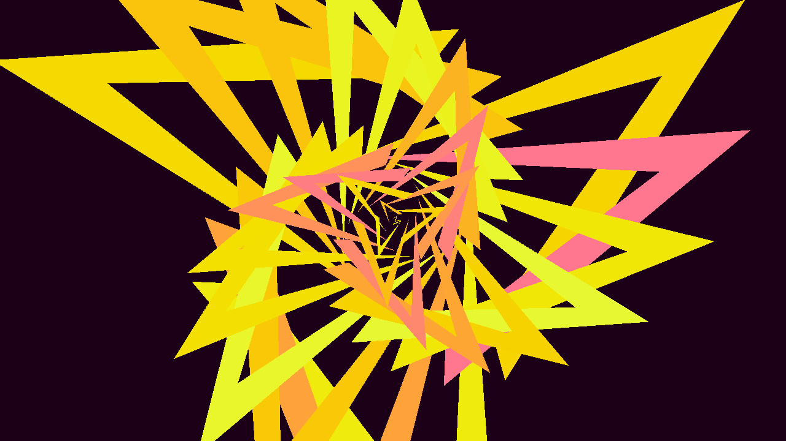
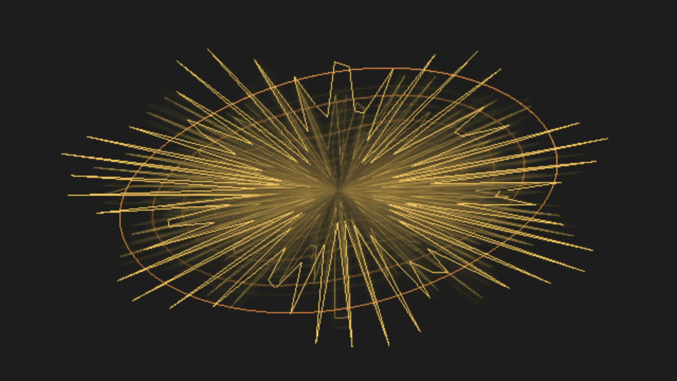

# EYESY Platform

A GPU-accelerated engine for the [Critter & Guitari EYESY](https://www.critterandguitari.com/eyesy)
video synthesizer. You write modes in Lua, and the EYESY's own GPU renders them
with OpenGL ES 2 at up to 60 fps, with full stereo audio analysis, shaders and
video feedback. The knobs, buttons, scenes, knob sequencer and on-screen display
work the same way they do on the stock OS.



<sub>The `spirolateral` preset from the [MilkDrop pack](#mode-packs), captured from
the EYESY's HDMI output, where it runs at 29 fps.</sub>

> [!NOTE]
> **This is an unofficial project.** It is not affiliated with or endorsed by
> Critter & Guitari. It installs alongside the stock EYESY OS, and one command
> hands the running instrument back to stock. Read [Status](#status) before you
> install it on your instrument.

## Why a new engine?

The EYESY OS v3 that ships today is written in Python. It draws every frame
with pygame on the CPU and caps output at 30 fps, so the GPU renders nothing.
The first-generation EYESY_OF ran Lua modes on openFrameworks with OpenGL, but
it needs Broadcom GL libraries that current KMS-based images no longer ship and
an `eyesy.lua` library that was never published, and it has not been updated
since 2022. This platform keeps the instrument and replaces the engine.

| | Stock EYESY OS v3 | EYESY_OF (first generation) | **This platform** |
| --- | --- | --- | --- |
| Rendering | pygame, on the CPU | OpenGL ES 2 via the legacy Broadcom libraries | **OpenGL ES 2 on the VC4 GPU (Mesa), scanned out directly with KMS** |
| Frame rate | Capped at 30 fps | No 30 fps cap | **Up to 60 fps**: simple modes hold 60, and heavy shader scenes run at about 17–50 |
| Mode language | Python | Lua with raw openFrameworks bindings | **Lua (LuaJIT) with a versioned, documented API** |
| Shaders and feedback | None | Possible through raw openFrameworks | **Fragment shaders with hot reload, 8 render targets for feedback, reusable meshes, 3D camera and depth** |
| Audio given to modes | 100 averaged samples per channel | 256 samples at 11 kHz, left channel only | **1,024 samples per channel at 48 kHz, a 513-bin FFT per channel, 3 bands, RMS/peak, and a waveform texture for shaders** |
| MIDI given to modes | Note states | Last note and velocity | **Notes, all 128 CCs, clock, transport and timestamped events** |
| Mode isolation | Every mode loads into one Python process at boot, and module state survives mode switches | Not documented | **A fresh Lua state for every load and reload** |
| Runs on the current EYESY image | Yes | Needs the legacy GL stack | **Yes, alongside stock** |
| Instrument controls | The reference | Basic: modes, scenes, OSD, screenshots and trigger | **Stock-compatible: shift shortcuts, knob sequencer, HUD, 43 palettes, config menu, LED and trigger tone** |

## What you get

- **GPU graphics.** The engine draws finished frames straight to HDMI through
  KMS, with no X server. Shaders, feedback targets, meshes, images and a
  depth-tested camera make reaction–diffusion, fractal zooms and MilkDrop-style feedback
  practical on a Compute Module 3+. Modes are benchmarked on the device itself:
  simple ones hold 60 fps, heavy shader scenes run at about 17–50, and most
  MilkDrop presets hold about 30. See [the performance
  tiers](docs/SCENE-LIBRARY.md#performance-tiers).
- **Audio that never stalls.** Capture runs on its own thread and writes to a
  non-blocking ring buffer, so a slow frame never blocks audio. A
  3-million-frame stress test of that buffer passes under ThreadSanitizer.
- **It still works like an EYESY.** The controls follow the EYESY OS v3 manual:
  shift shortcuts, palette cycling, saving, updating and deleting scenes, the
  knob sequencer with its LED colours, input gain on Shift + knob 1, the trigger
  test tone, the 43 stock palettes (or your own `System/palettes.json`), and a
  configuration menu with a hardware test screen. A 13-step suite drives these
  controls on the device over OSC and checks the HDMI output at every step.
- **A mode error won't stop the show.** A Lua error brings up an error screen
  while the controls stay live, so you can switch modes or fix the file and let
  it reload. A shader that fails to compile leaves the last working one running.
  The engine runs under a systemd watchdog, and if it cannot start, systemd
  hands the instrument back to the stock OS. That recovery path has been tested
  on hardware.
- **Develop on your computer.** The same engine runs on a Linux desktop, with
  hot reload of Lua and shader files and the keyboard standing in for the
  controls. You can feed in a WAV file instead of live audio, record and replay
  control input, and render headless for automated checks. You can also run a
  package on the EYESY's GPU with no display attached and pull back screenshots
  and timings. `tools/scene_verify.py` sweeps every knob and audio condition and
  flags any control that doesn't change the picture.
- **Safe to install and remove.** Builds run in containers on a digest-pinned
  Debian base, against checksummed SDKs, and release archives are
  byte-reproducible. A deploy checks the card's identity and the archive,
  stages the release next to the running one, switches with an atomic symlink,
  and keeps it only if frames advance on the GPU. Otherwise it restores the
  previous release or the stock OS. `eyesyctl rollback` returns to either one at
  any time. The stock software stays installed, and only one of the two runs at
  a time.
- **Backed by recorded runs.** 60-minute soaks across 30 modes ran with no
  crashes and a flat temperature. A 216,000-frame run with 1,800 mode reloads
  grew memory by 80 KiB; a later soak over the larger catalog measured about
  73 KB per reload, which is still being tracked down. ASan, UBSan and
  ThreadSanitizer cover the engine core on the workstation. The run reports are
  kept privately because they are full of device logs, and the
  [status](docs/STATUS.md) page summarises them.

| | |
| --- | --- |
|  |  |
| The configuration menu | The stock-layout HUD over `starter`, at 60 fps |

<sub>Both captured from the EYESY's HDMI output.</sub>

## Status

This is a working development platform. It boots and runs on a CM3+ EYESY with
OS v3.0. Release manifests keep `hardware_validated: false` until the last
manual checks are done: knob and button feel, a known stereo signal on the line
input, HDMI display latency, and recovery after a cold boot. See the
[implementation status](docs/STATUS.md) and the [roadmap](ROADMAP.md).

Current limitations:

- **Hardware.** Tested only on a CM3+ EYESY with OS v3.0. CM4 units are
  untested, and the deploy tool refuses them.
- **Output.** 1280×720 over HDMI only, with no composite video or native 1080p.
- **Stock modes.** Stock Python modes must be ported to Lua; the [factory
  pack](#mode-packs) is doing that.
- **Setup.** There is no Wi-Fi setup or web editor. You install and manage the
  platform over SSH from a Linux workstation with `eyesyctl`, and the stock web
  editor controls only the stock OS.
- **Menu.** No Wi-Fi, MIDI program-change, backup or log screens, and loading
  modes from a USB drive isn't ported.
- **Persist.** The Persist button affects only modes that read
  `ctx.auto_clear`. Most modes still clear the screen every frame.
- **Known issue.** After many MIDI device connects and disconnects in one
  session, MIDI input can stop responding until the engine restarts.

## Getting started

### Requirements

- An x86-64 Linux workstation with:
  - Python 3.9 or newer
  - Rootless Podman, with qemu-user-static for ARM builds
  - curl, patch and file, for fetching and patching the SDK
  - CMake, Ninja and g++, for the native tests
  - An OpenSSH client, for installing on the instrument
- To install on the instrument: a CM3+ EYESY on OS v3.0, and a spare microSD
  card. Keep your original card untouched.

### Run it on your desktop

```sh
git clone https://github.com/BrettKinny/eyesy-platform.git
cd eyesy-platform
./eyesyctl bootstrap                               # build container + checksummed openFrameworks SDK
./eyesyctl build
./eyesyctl test
./eyesyctl preview starter --headless --frames 120 # software rendering, no GPU needed
./eyesyctl prepare-native
./eyesyctl preview starter --native                # a window on your GPU
```

The first `bootstrap` downloads about 340 MB of SDK, and the first build takes
a minute or two. Headless runs use software rendering, so they check
correctness but don't measure performance; each one saves its last frame to
`local/preview/grabs/`. Files passed to `--audio-wav`, `--replay` or `--record`
must be inside the repo, for example under `local/`.

In the desktop preview, these keys stand in for the hardware controls:

| Key | Action | Key | Action |
| --- | --- | --- | --- |
| 1–5 | Select a knob | O | Toggle the OSD |
| Up / Down | Adjust the selected knob | C | Toggle clearing |
| Left / Right | Switch modes | S | Save a scene |
| R | Reload | [ / ] | Recall scenes |
| Space | Trigger | G | Save a screenshot |
| N | Simulate a MIDI note | M | Open settings |

In settings, Up/Down selects a row, Left/Right changes its value, Enter opens a
screen, and Backspace or Esc goes back. Settings are saved when you leave the
menu.

### Mode packs

This repo contains the engine and one mode, `starter`. Other modes live in
**mode packs**: repos that each hold a flat set of mode folders, laid out like
the EYESY's `/sdcard/Modes`. `eyesyctl` finds any `eyesy-modes-*` directory
next to this repo.

| Pack | Contents |
| --- | --- |
| [`eyesy-modes-factory`](https://github.com/BrettKinny/eyesy-modes-factory) | Lua ports of the stock Critter & Guitari OS v3 library (87 of 108 so far) |
| [`eyesy-modes-milkdrop`](https://github.com/BrettKinny/eyesy-modes-milkdrop) | A MilkDrop-style preset engine: one mode that plays a catalog of Lua-defined presets through warp and composite shader passes |

| | | |
| --- | --- | --- |
|  |  |  |
| Factory: `s-arcway` | Factory: `s-amp-color-5gon-filled` | Factory: `s-grid-triangles-unfilled-column-color` |
|  |  | |
| MilkDrop: `kaleido-fold`, 33 fps | MilkDrop: `painterly-flow`, 33 fps | |

<sub>The MilkDrop stills are captured from the EYESY's HDMI output, driven by
its trigger test tone. The factory stills are desktop renders from the same
engine.</sub>

```sh
cd ..
git clone https://github.com/BrettKinny/eyesy-modes-factory.git
git clone https://github.com/BrettKinny/eyesy-modes-milkdrop.git
cd eyesy-platform
./eyesyctl modes list
./eyesyctl preview milkdrop --native
```

`preview` finds modes in the packs directly. Before you run `package` or
`tools/scene_verify.py`, run `./eyesyctl modes sync` to copy the packs into
`modes/`.

### Write a mode

A mode is a folder with a `main.lua` file, plus any shaders and images it uses.
This is the whole `starter` mode:

```lua
local e = eyesy
return {
  api_version = 1,
  setup = function(ctx)
    e.param("size", 0.5, 0.05, 1, 1)
    e.param("hue", 0.5, 0, 1, 4)
  end,
  draw = function(ctx)
    if ctx.auto_clear then
      e.clear(0.025, 0.035, 0.06)
    else
      -- Persist on: decay the previous frame instead of wiping it.
      e.color(0.025, 0.035, 0.06, 0.08)
      e.rect(0, 0, ctx.width, ctx.height)
    end
    e.color(e.palette(ctx.params.hue))
    e.circle(ctx.width / 2, ctx.height / 2,
      30 + ctx.params.size * 180 + ctx.audio.rms_left * 80)
    e.color(1, 1, 1)
    e.text("Your next mode starts here", 32, 48)
  end
}
```

To start your own pack with a copy of `starter` and preview it:

```sh
mkdir ../eyesy-modes-mine
./eyesyctl new-mode my-scene --pack ../eyesy-modes-mine
./eyesyctl preview my-scene --native
```

The [mode API](docs/API.md) covers the full interface. The [scene library
conventions](docs/SCENE-LIBRARY.md) cover the knob contract and the performance
budgets that shipped modes must meet.

### Install on the EYESY

Read [deployment](docs/DEPLOYMENT.md) in full before you start. In outline:

1. Clone your original SD card to a spare card, and verify the copy.
2. Run `tools/prepare_clone.py` on the spare card to install your SSH key and
   enable SSH.
3. Download the archive from [Releases](https://github.com/BrettKinny/eyesy-platform/releases),
   or build your own with `./eyesyctl bootstrap --arm`, `build --arm`,
   `modes sync` and `package --arm`. Don't run a desktop build at the same
   time, because both builds share the source tree.
4. Prepare the device with `./eyesyctl provision`, then install the release with
   `./eyesyctl deploy`.
5. Choose which software the instrument starts at boot; see [boot
   selection](docs/DEPLOYMENT.md#boot-selection).
6. Check the device with `./eyesyctl status` and `./eyesyctl logs`, and go back
   with `./eyesyctl rollback --target previous` or `--target stock`.

The device commands all take the device's `--host` and the `--clone-id` you
gave the card. To test a package on the device without a screen first, see
[headless development](docs/HEADLESS-DEVELOPMENT.md).

## How it works

The engine is a C++ openFrameworks 0.12.1 application that embeds LuaJIT, with
its own small binding layer. On the EYESY it takes over the display through KMS
and picks an HDMI mode from the display's EDID. Knobs and buttons arrive from
the stock `eyesyhw` daemon over OSC on port 4000, and LED colours go back on
port 4001. Audio comes from the codec through ALSA, and MIDI through ALSA
sequencer ports.

| Path | What it holds |
| --- | --- |
| `engine/src/` | The engine: main loop, Lua runtime and API, audio capture and FFT, KMS/GBM display, HUD, menu, knob sequencer, palettes |
| `eyesyctl` | The CLI for bootstrap, build, test, preview, package, provision, deploy, status and rollback |
| `deploy/` | systemd units for the platform and its fallback to stock |
| `tools/` | Release, provisioning, benchmarking, scene-verification and hardware probe tools |
| `tests/` | Native C++ tests (CTest) and Python tests: unit tests, graphics integration and device suites |
| `docs/` | API, workflow and hardware documentation; see the list below |

The switch to direct KMS came out of a hardware bug: on this board, any Xorg
session left the HDMI transmitter sending sync with blank pixels until the next
power cycle. [HDMI display issue](docs/HDMI-DISPLAY-ISSUE.md) traces the root
cause down to the register bit.

## Documentation

- [Mode API](docs/API.md): the Lua interface modes are written against
- [Scene library conventions](docs/SCENE-LIBRARY.md): the knob contract, performance tiers and optimization notes
- [Creative runtime](docs/CREATIVE.md): palettes, Persist and the reference modes
- [Input workflow](docs/INPUT-WORKFLOW.md): WAV input and event record/replay
- [Display backends](docs/DISPLAY-BACKENDS.md): the direct KMS and offscreen windows, and the GPU probe
- [Headless development](docs/HEADLESS-DEVELOPMENT.md): testing on the device's GPU without a screen
- [Deployment](docs/DEPLOYMENT.md): preparing a card, provisioning, deploying and rolling back
- [EYESY OS v3 parity](docs/EYESY-OS-V3-PARITY-PLAN.md): how the stock instrument layer was ported and verified
- [Implementation status](docs/STATUS.md) and [roadmap](ROADMAP.md): what is done and what is open
- [Bench checklist](docs/BENCH-CHECKLIST.md): the remaining hardware acceptance checks
- Background research, written before the engine existed:
  [the stock OS architecture](docs/background/stock-os-architecture.md),
  [the earlier EYESY_OF engine](docs/background/eyesy-of-engine.md) and
  [the original ideas list](docs/background/ideas.md)

## Upstream sources

- [critterandguitari/EYESY_OS](https://github.com/critterandguitari/EYESY_OS): the stock OS (Python engine, web editor, CM3/CM4 platform layer)
- [critterandguitari/EYESY_Modes_OSv3](https://github.com/critterandguitari/EYESY_Modes_OSv3): the stock mode library
- [critterandguitari/EYESY_OF](https://github.com/critterandguitari/EYESY_OF): the earlier openFrameworks + Lua engine
- [critterandguitari/EYESY_oFLua_Examples](https://github.com/critterandguitari/EYESY_oFLua_Examples): example modes for EYESY_OF

## AI assistance

Much of the code and documentation here was written with AI coding assistants
(mainly Claude), working under the author's direction. The hardware claims in
this README come from runs on a real EYESY, not from the assistants.

## License

This project is released under the BSD 3-Clause License; see [LICENSE](LICENSE).
Parts of it are ported from Critter & Guitari's EYESY OS, which is also under
BSD 3-Clause. [THIRD_PARTY_NOTICES.md](THIRD_PARTY_NOTICES.md) lists those parts
and the other components.

EYESY is a trademark of Critter & Guitari, Inc. It is used here only to name the
hardware this software runs on.
